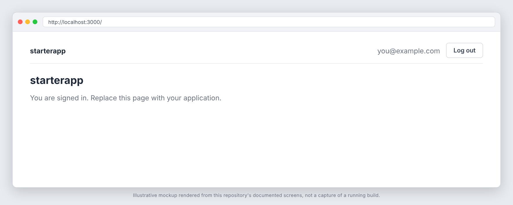
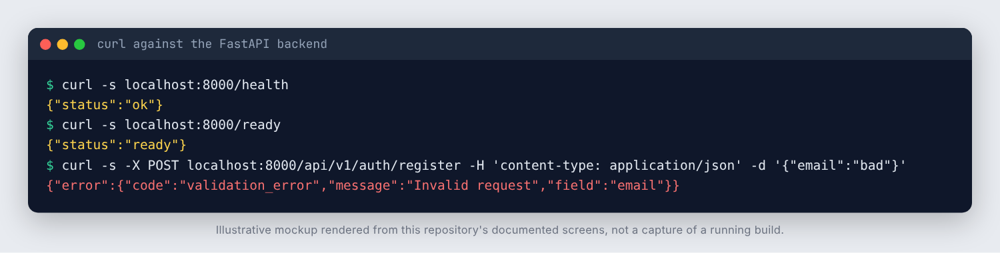

# starterapp

A full-stack starter: a FastAPI backend (SQLAlchemy 2, Alembic, Postgres,
Redis) and a Next.js 16 frontend, with real password authentication, a
single JSON error contract, rate limiting, structured logging, Docker images,
tests and CI already wired together. Everything domain-specific has been
removed; what remains is the plumbing every project of this shape needs.

## Screenshots





_These images are illustrative mockups rendered from this repository's documented screens and API shapes, not captures of a running build. Regenerate or replace them with real captures once the app is running._

## What is included

Backend (`backend/`)
- FastAPI app with `/health` (liveness) and `/ready` (Postgres check).
- Auth: register, login, `GET /api/v1/auth/me`. PBKDF2-SHA256 password
  hashes, HS256 JWT bearer tokens, constant-work login (no username-enumeration
  timing oracle), Redis-backed login and register rate limits.
- One error contract for every failure: `{"error": {"code", "message", "field"}}`
  (`api/errors.py`, handlers in `main.py`). A 422 `validation_error` also
  carries `fields`, every problem keyed by field name, so a form can show them
  all at once.
- Pagination helper (`api/pagination.py`): the `PageParams` dependency
  (`?page=` from 1, `?per_page=` default 20, max 100, bad values are a 422),
  the `Page[T]` envelope `{items, page, per_page, total, total_pages}`, and
  `paginate(db, stmt, params, convert)` for SQLAlchemy selects.
- SQLAlchemy models, Alembic migrations, and a two-role Postgres setup: the
  app connects as a restricted role with no DDL rights; migrations run as the
  admin role.
- Structured JSON logging with request IDs.
- Tests against real Postgres and Redis: auth boundary, rate limits, grants.
- ruff, mypy (strict), bandit, pip-audit; dev and production Dockerfiles.

Frontend (`frontend/`)
- Next.js 16 App Router, React 19, TypeScript.
- Same-origin proxy design: the browser only talks to Next. Route handlers
  under `app/api/` hold the session token in an httpOnly cookie and forward it
  to the backend as a bearer token (`lib/backend.ts`). `app/api/v1/[...path]`
  proxies any backend `/api/v1/*` call.
- Auth context, sign-in/register form with per-field errors, auth gate,
  `ApiError` (with `fields`) + friendly error messages, a `useAsync` data hook.
- Shared components in `components/ui/`, each with a test: `Button` (loading
  state), `FormField` (label, hint, field errors, `aria-describedby`), `Alert`,
  `Spinner`, `EmptyState`, `Modal` (focus in and back, Escape, backdrop),
  `Pagination`, `DataTable` (typed columns, empty and loading states).
  `lib/pagination.ts` holds the `Page<T>` type and `pageWindow`. Import from
  `@/components/ui`.
- Root layout with a skip link, `app/error.tsx`, `app/global-error.tsx`,
  `app/not-found.tsx` and `app/loading.tsx`.
- Vitest + Testing Library; ESLint 9 with `eslint-config-next` 16 (flat config);
  dev and standalone production Dockerfiles.

Repository
- `docker-compose.yml` (dev) and `docker-compose.prod.yml` (production-shaped).
- GitHub Actions CI with every action pinned to a commit SHA: lint, types,
  tests, pip-audit, npm audit, gitleaks, osv-scanner, CodeQL (code and
  workflows).
- Dependabot, issue/PR templates, SECURITY.md, CONTRIBUTING.md, MIT LICENSE
  placeholder, empty `docs/project-memory/` scaffold.

## Getting started

1. Rename the placeholder. It must be lowercase letters and digits:

   ```
   ./rename.sh acmeportal AcmePortal
   rm rename.sh
   ```

2. Update the `LICENSE` copyright line and `SECURITY.md`.
3. Run the stack:

   ```
   cp .env.example .env
   docker compose up --build
   ```

   Backend: http://localhost:8010/docs. Frontend: http://localhost:3001.

## Developing without Docker

Postgres and Redis must be running; the test defaults expect Postgres on
`localhost:5433` and Redis on `localhost:6380` (what `docker-compose.yml`
publishes). Override with `DATABASE_ADMIN_URL`, `DATABASE_URL`, `REDIS_URL`.

```
cd backend
python -m venv .venv && . .venv/bin/activate
pip install -e '.[dev]'
alembic upgrade head
ruff check . && ruff format --check . && mypy src && bandit -q -r src
pytest -q
uvicorn starterapp.main:app --reload
```

```
cd frontend
npm ci
npm run lint && npm run typecheck && npm test && npm run build
BACKEND_URL=http://localhost:8010 npm run dev
```

## Adding your domain

1. Add models to `backend/src/starterapp/db/models.py`, then a migration
   (`alembic revision --autogenerate -m "..."`). Grant the new table to the
   runtime role and add it to `ALL_TABLES` in `tests/conftest.py`.
2. Add a router under `api/`, protect routes with `Depends(get_caller)`, raise
   errors through `api/errors.py`, and register the router in `main.py`.
3. Mirror response types in `frontend/lib/types.ts` and call the endpoint with
   `apiGet`/`apiSend` from `lib/api-client.ts` (the catch-all proxy already
   forwards `/api/v1/*`).
4. Add friendly messages for new error codes in
   `components/ApiErrorMessage.tsx`.
5. For a list endpoint, take `params: PageParams = Depends()` and return
   `paginate(...)`; on the frontend render it with `DataTable` and
   `Pagination`, and request `/api/v1/things${pageQuery(page)}`.

## Security notes

- `JWT_SECRET_KEY` has a labelled dev-only default. Override it everywhere
  real. Tokens are not server-side revocable; logout only clears the cookie.
- Set `COOKIE_SECURE=true` once the app is served over HTTPS.
- `osv-scanner.toml` and `.gitleaksignore` ship empty. A fresh `npm install`
  may report a dev-only advisory (for example `braces`); add a dated entry to
  `osv-scanner.toml` only after reviewing it.

## License

MIT. Update the copyright line in `LICENSE` for your project.
